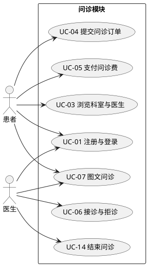
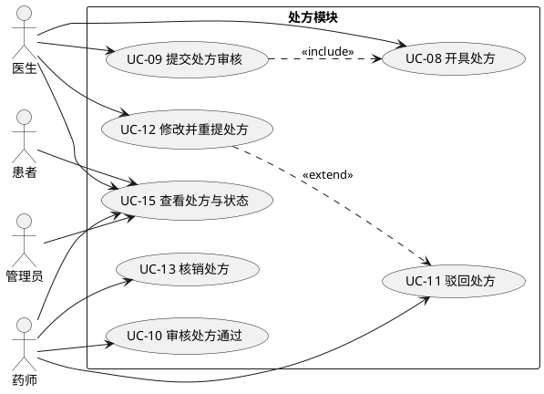
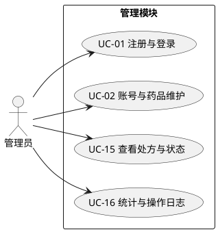
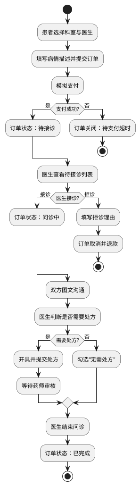
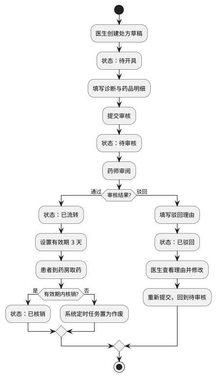
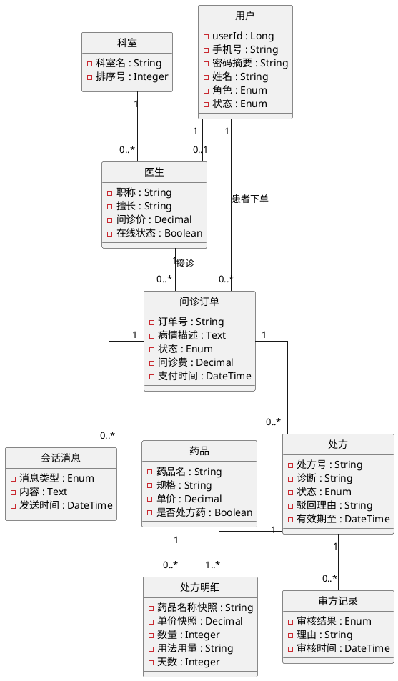
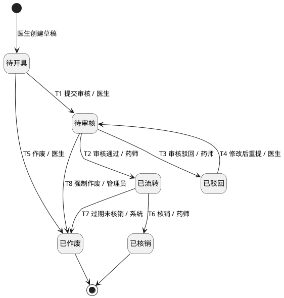

# 智慧医疗在线问诊与处方流转平台 · 需求规格说明书

| 项 | 内容 |
|---|---|
| 版本 | v1.0 |
| 日期 | 2026-10-25 |
| 编写 | 李（组长，需求与项目管理） |
| 小组 | 6 人：李、王、张、刁、皮、牛 |
| 对应 | 实验一《需求分析与迭代规划》，实验报告第 1 章 |
| 用途 | 作为五个 Sprint 的需求基线；实验二的设计、实验三的实现、实验四的测试均以此为准 |

---

## 1 项目概述与迭代规划

### 1.1 项目背景与目标

常见病复诊患者往返医院排队耗时，轻症咨询占用门诊资源；处方从开具到调剂缺少可追溯的电子记录。本平台把这段流程线上化，连接患者、医生与药房，形成「在线问诊 → 电子处方 → 药师审核 → 处方流转 → 药房核销」的闭环。

目标用户是四类角色：患者（发起问诊）、医生（接诊开方）、药师（审方发药）、管理员（维护基础数据）。平台的价值不在于功能多，而在于**每一次问诊和每一张处方的状态变化都有人、有时间、有据可查**。

范围边界：

- 本期**不接入**真实支付通道、医保结算与视频问诊；问诊费为模拟支付，点击即成功。
- 药品**不扣库存**，不做采购与物流。
- 处方审核、核销为流程模拟，不替代真实医疗行为，所有演示数据均为虚构。

### 1.2 迭代规划

采用 1–2 周一个 Sprint，每个 Sprint 结束交付一个**可运行、可演示**的软件增量。增量按业务链路纵向切分（一条从页面到数据库的完整链路），而不是按前端/后端或按层次切分。

**迭代计划**

| Sprint | 周期 | 核心目标 | 可演示增量 | 涉及用例 |
|---|---|---|---|---|
| S0 基线 | 3–5 天 | 仓库骨架、数据库、统一响应体、登录 | 四类账号分别登录并进入各自工作台 | UC-01 |
| S1 找医生下单 | 1 周 | 医生目录、问诊订单、模拟支付、接诊 | 患者选医生下单→支付→医生接诊→订单变「问诊中」 | UC-02、UC-03、UC-04、UC-05、UC-06 |
| S2 问诊与开方 | 1–2 周 | 图文会话、处方草稿、提交审核 | 双方互发消息→医生开方（2 条药）→提交→处方变「待审核」 | UC-07、UC-08、UC-09 |
| S3 审方 | 1–2 周 | 审方通过、驳回、修改重提 | 药师驳回→医生看到理由并改方→重提→药师通过→处方变「已流转」 | UC-10、UC-11、UC-12、UC-15 |
| S4 核销收尾 | 1–2 周 | 核销、结束问诊、权限与部署 | 药师核销→医生结束问诊→越权访问返回 403→一键部署 | UC-13、UC-14、UC-16 |

三条执行规则，Sprint 评审时按此检查：

1. **每个 Sprint 必须能演示一条完整链路**，不是「接口写完了」。演示脚本见附录 B。
2. **数据库表按 Sprint 增量创建**：S1 建 3 张、S2 建 4 张、S3 建 1 张、S4 建 1 张，不一次建全。
3. **处方状态机的迁移逐条开放**：S2 只开「提交审核」，S3 开「通过/驳回/重提」，S4 开「核销/过期作废」。状态机在第 4 周就能跑起来，而不是留到最后联调。

初始产品 Backlog 即 2.2 节的 16 个用例，按优先级 P0/P1/P2 排入 Sprint；用 GitHub Projects 看板管理（Backlog / Sprint Backlog / In Progress / Review / Done）。

---

## 2 系统用例分析

### 2.1 角色分析

**表 1-1 角色列表**

| 编号 | 角色名 | 所属部门 | 简要描述 |
|---|---|---|---|
| 1 | 患者 | 门诊（线上） | 注册登录、浏览医生、发起并支付问诊、图文沟通、查看处方 |
| 2 | 医生 | 临床科室 | 接诊或拒诊、图文问诊、开具并提交处方、结束问诊 |
| 3 | 药师 | 药房 | 审核处方、驳回处方、核销发药 |
| 4 | 管理员 | 信息科 | 维护账号与药品目录、只读查看处方、查看统计与操作日志 |
| 5 | 系统 | 后台定时任务 | 不对应用例，是订单超时关闭与处方过期作废的触发者（非人工角色） |

**角色权限边界**，实现时三条规则缺一不可：

1. **角色**：接口按角色放行，患者不能调用审方接口。
2. **归属**：只能操作与自己相关的数据——患者只能看自己的订单，医生只能看自己接诊的订单。
3. **状态**：只有当前状态允许的动作才放行，例如只有「待审核」的处方才能被审方。

### 2.2 用例分析

**表 1-2 用例列表**（只列基本用例；作废处方、评价医生等 P2 用例不在表内）

| 编号 | 用例名称 | 角色 | 优先级 | 描述（交付 Sprint） |
|---|---|---|---|---|
| UC-01 | 注册与登录 | 患者、医生、药师、管理员 | P0 | 患者手机号注册；统一登录后按角色进入各自工作台（S0） |
| UC-02 | 账号与药品维护 | 管理员 | P1 | 创建医生/药师账号、启停账号；维护药品目录（S1–S2） |
| UC-03 | 浏览科室与医生 | 患者 | P0 | 按科室筛选医生，查看职称、擅长、问诊价与在线状态（S1） |
| UC-04 | 提交问诊订单 | 患者 | P0 | 选医生、填病情描述（10–500 字），生成「待支付」订单（S1） |
| UC-05 | 支付问诊费 | 患者 | P0 | 模拟支付，订单转「待接诊」，记录支付时间（S1） |
| UC-06 | 接诊与拒诊 | 医生 | P0 | 接诊转「问诊中」；拒诊须填理由，订单取消并退款（S1） |
| UC-07 | 图文问诊 | 患者、医生 | P0 | 订单内收发文字与图片，消息落库，结束后只读（S2） |
| UC-08 | 开具处方 | 医生 | P0 | 填写诊断与药品明细（含用法用量），保存为「待开具」草稿（S2） |
| UC-09 | 提交处方审核 | 医生 | P0 | 校验通过后提交，处方转「待审核」，进入药师队列（S2） |
| UC-10 | 审核处方通过 | 药师 | P0 | 药师审核通过，处方转「已流转」，设置 3 天有效期（S3） |
| UC-11 | 驳回处方 | 药师 | P0 | 填写驳回理由（≥10 字），处方转「已驳回」并通知医生（S3） |
| UC-12 | 修改并重提处方 | 医生 | P1 | 查看驳回理由、修改明细、重新提交，回到「待审核」（S3） |
| UC-13 | 核销处方 | 药师 | P0 | 有效期内核销发药，处方转「已核销」，重复核销报错（S4） |
| UC-14 | 结束问诊 | 医生 | P0 | 已有「已流转」处方，或勾选「无需处方」后结束问诊（S4） |
| UC-15 | 查看处方与状态 | 患者、医生、药师、管理员 | P0 | 按角色查看处方详情、用法用量与状态时间线（S3） |
| UC-16 | 统计与操作日志 | 管理员 | P2 | 订单量、处方量、驳回率与核销率；操作日志查询（S4） |

> P2 用例（作废处方、评价医生）本期不实现，作为 Backlog 余量，需要时再排。

### 2.3 用例建模

按功能模块拆成三张用例图：问诊、处方、管理。事件流最复杂的两个用例另配活动图。

**图 1-1 问诊模块用例图**（源码：`docs/diagrams/use-case-consultation.puml`）

**图 1-2 处方模块用例图**（源码：`docs/diagrams/use-case-prescription.puml`）

**图 1-3 管理模块用例图**（源码：`docs/diagrams/use-case-admin.puml`）

说明：UC-15 由四类角色共用，定义见图 1-2 与表 1-2；管理图中只体现管理员的只读参与，可查看全部处方（不受 2.1 节「归属」限制）。管理员对处方唯一的写操作 T8 属 P2，本期不实现；定时任务不单独设用例，规则见附录 A.5。

**图 1-4 活动图：问诊主流程**（源码：`docs/diagrams/activity-consultation.puml`）

**图 1-5 活动图：处方流转**（源码：`docs/diagrams/activity-prescription.puml`）

这两个用例画活动图，是因为它们跨越三个角色、分支多（支付失败、拒诊、驳回、过期），文字描述容易漏出口。

### 2.4 数据建模

#### 2.4.1 名词短语分析

从 2.2 的用例描述中提取名词，得到候选类，再按「是否有属性与行为、是否需要独立生命周期」筛选：

**表 1-3 候选类筛选**

| 候选名词 | 处理 | 理由 |
|---|---|---|
| 患者、医生、药师、管理员 | 合并为「用户」，用角色区分 | 字段高度重合，登录与权限统一处理 |
| 医生 | 保留为「医生」，作为用户的扩展 | 有职称、擅长、问诊价、在线状态等专属属性 |
| 科室 | 保留 | 独立字典，医生归属科室 |
| 问诊订单 | 保留 | 核心业务对象，有自己的状态与生命周期 |
| 会话消息 | 保留 | 绑定订单，需独立存储与查询 |
| 处方、处方明细 | 保留为两个类 | 主从关系，明细有独立属性（用法、用量、天数） |
| 药品 | 保留 | 独立维护，被处方明细引用 |
| 审方记录 | 保留 | 一次审核一条，需留痕 |
| 支付 | 并入问诊订单的字段 | 只有支付时间与金额，无独立行为 |
| 操作日志 | 不进域模型，建表即可 | 纯技术记录，不参与业务规则 |
| 评价 | 本期不建模（P2） | 不影响主闭环 |

筛选结果：**9 个领域类**——用户、医生、科室、问诊订单、会话消息、处方、处方明细、药品、审方记录。

#### 2.4.2 CRC 分析

**表 1-4 CRC 卡片**

| 类名 | 职责 | 协作者 |
|---|---|---|
| 用户 User | 保存账号、密码与角色；判断能否登录；提供角色判别 | 医生、问诊订单 |
| 医生 Doctor | 维护职称、擅长、问诊价、在线状态；判断当前能否接诊 | 科室、问诊订单、处方 |
| 科室 Department | 归类医生，提供按科室筛选 | 医生 |
| 问诊订单 ConsultationOrder | 记录一次问诊的交易与状态；生成订单号；判断能否接诊、能否结束 | 用户、医生、会话消息、处方 |
| 会话消息 Message | 保存消息内容、发送者与时间；只允许订单双方访问 | 问诊订单、用户 |
| 处方 Prescription | 记录诊断与处方状态；校验能否提交、审核、核销；维护有效期 | 问诊订单、医生、处方明细、审方记录 |
| 处方明细 PrescriptionItem | 记录药品快照、数量与用法用量；计算小计金额 | 处方、药品 |
| 药品 Drug | 维护药品名称、规格、单价与是否处方药；控制能否开方 | 处方明细 |
| 审方记录 Review | 记录审核结果、理由、审核人与时间；不可修改 | 处方、用户 |

#### 2.4.3 领域模型

**图 1-6 领域模型类图**（源码：`docs/diagrams/domain-model.puml`）

说明：本图只表达业务概念与关系；字段的完整定义、主外键与索引在实验二的数据库设计中给出。处方明细保存药品名称与单价的**快照**，药品后续调价不影响历史处方。

---

## 3 非功能需求

| 编号 | 类别 | 要求 | 验证方式 |
|---|---|---|---|
| NFR-01 | 安全 | 密码用 BCrypt 存储；认证用 JWT，有效期 2 小时；越权访问统一返回 403 且不泄露资源是否存在 | 越权用例（患者 A 访问患者 B 的订单） |
| NFR-02 | 安全 | 所有写接口做参数校验（长度、范围、枚举），非法输入返回 400 而非 500；查询使用参数化 SQL | 接口测试 |
| NFR-03 | 一致性 | 处方状态迁移使用乐观锁，两人同时对同一处方操作时只有一次成功，另一次返回 409 | 双浏览器并发点击 |
| NFR-04 | 性能 | 列表接口 P95 < 500 ms；页面首屏可交互 < 3 s（本地环境） | 浏览器 Network 与日志 |
| NFR-05 | 隐私 | 手机号列表脱敏（138****8000）；日志不打印密码与 token；演示数据均为虚构 | 代码审查 |
| NFR-06 | 可用性 | 失败操作给出中文提示且可继续操作；核销、驳回、作废需二次确认 | 手工走查 |
| NFR-07 | 兼容性 | Chrome / Edge 最新版，1366×768 及以上分辨率可正常使用 | 手工走查 |
| NFR-08 | 可部署性 | `docker-compose up` 一条命令启动 MySQL、后端与前端；`init.sql` 可重复执行 | S4 演示环境验收 |

---

## 附录 A 处方状态机

处方是本选题的**分析与设计重点**，生命周期单独建模。状态共 6 个，迁移 8 条；迁移表在实现时直接作为代码里的迁移白名单。

### A.1 状态定义

| 状态 | 编码 | 含义 | 可否编辑 |
|---|---|---|---|
| 待开具 | DRAFT | 医生已创建，尚未提交 | 可编辑 |
| 待审核 | PENDING_REVIEW | 已提交，等待药师审核 | 不可编辑 |
| 已驳回 | REJECTED | 药师驳回，退回医生 | 可修改后重提 |
| 已流转 | CIRCULATED | 审核通过，患者可缴费取药 | 不可编辑 |
| 已核销 | DISPENSED | 药房已发药，终态 | 不可编辑 |
| 已作废 | CANCELLED | 作废，终态 | 不可编辑 |

### A.2 状态图

**图 A-1 处方状态图**（源码：`docs/diagrams/state-prescription.puml`）

### A.3 迁移表

| # | 源 | 目标 | 触发动作 | 操作角色 | 前置条件 | 副作用 |
|---|---|---|---|---|---|---|
| T1 | 待开具 | 待审核 | 提交审核 | 医生（开方人） | 诊断非空；明细 1–5 条；药品为启用状态 | 记录提交时间，进入药师队列 |
| T2 | 待审核 | 已流转 | 审核通过 | 药师 | 处方存在且未处理 | 记录审核人与时间；有效期 +3 天；写审方记录 |
| T3 | 待审核 | 已驳回 | 审核驳回 | 药师 | 驳回理由 ≥10 字 | 记录驳回理由；医生端可查看 |
| T4 | 已驳回 | 待审核 | 修改后重提 | 医生（开方人） | 修改后仍满足 T1 的校验 | 重新进入药师队列 |
| T5 | 待开具 | 已作废 | 作废草稿 | 医生（开方人） | 填写作废理由 | 记录操作人与时间 |
| T6 | 已流转 | 已核销 | 核销 | 药师 | 当前时间未超过有效期 | 记录核销人与时间；订单可结束 |
| T7 | 已流转 | 已作废 | 过期作废 | 系统（定时任务） | 当前时间超过有效期 | 记录系统作废 |
| T8 | 待审核 | 已作废 | 强制作废 | 管理员 | 填写作废理由 | 记录操作人；写审计日志 |

T5（作废草稿）与 T8（强制作废）同属 P2「作废处方」，本期不实现。图 A-1 保留这两条迁移是为了状态机完整；图 1-5 活动图只画本期实现的迁移（T1–T4、T6、T7）。

### A.4 三个设计说明

1. **为什么「已驳回」是独立状态，而不是退回「待开具」？** 驳回是药师留下的责任记录，必须能查到「哪一版被谁以什么理由驳回」。退回草稿会丢掉这段证据。
2. **为什么不允许「已流转 → 已驳回」？** 审核通过即对患者产生取药承诺，回退只能走作废并留痕，否则会出现处方凭空消失。
3. **两个人同时点「通过」怎么办？** 迁移语句写成 `UPDATE ... WHERE id=? AND status=? AND version=?`，影响行数为 0 返回 409。数据库是最终裁判，不靠前端禁用按钮。

### A.5 问诊订单状态（简表）

| 状态 | 编码 | 进入条件 | 离开条件 |
|---|---|---|---|
| 待支付 | PENDING_PAYMENT | 患者提交订单 | 支付 / 30 分钟超时 |
| 待接诊 | PENDING_ACCEPT | 支付成功 | 接诊 / 拒诊 / 24 小时超时 |
| 问诊中 | IN_CONSULTATION | 医生接诊 | 医生结束问诊 |
| 已完成 | COMPLETED | 结束问诊 | 终态 |
| 已取消 | CANCELLED | 未支付超时、拒诊、患者取消 | 终态 |

---

## 附录 B Sprint Backlog 与演示脚本

每个 Sprint 结束时按下面的步骤现场走一遍，走得通才算完成。

| Sprint | 演示步骤 | 通过标准 |
|---|---|---|
| S0 | 打开登录页 → 分别用患者、医生、药师、管理员账号登录 | 四个账号都能进入各自工作台，菜单与权限不同 |
| S1 | 患者登录 → 选科室和医生 → 填病情提交 → 支付 → 医生登录看到待接诊 → 接诊 | 订单状态从「待支付」变为「待接诊」再变为「问诊中」，数据库有对应记录 |
| S2 | 双方在订单内各发 3 条消息 → 医生开方（2 条药品明细）→ 保存草稿 → 提交审核 | 消息 3 秒内可见；处方状态变为「待审核」，出现在药师队列 |
| S3 | 药师驳回并填理由 → 医生看到理由 → 修改数量重提 → 药师通过 | 状态依次为「待审核→已驳回→待审核→已流转」，审方记录有两条 |
| S4 | 药师核销 → 医生结束问诊 → 患者 A 访问患者 B 的订单 | 状态变「已核销」「已完成」；越权请求返回 403；`docker-compose up` 可启动 |
