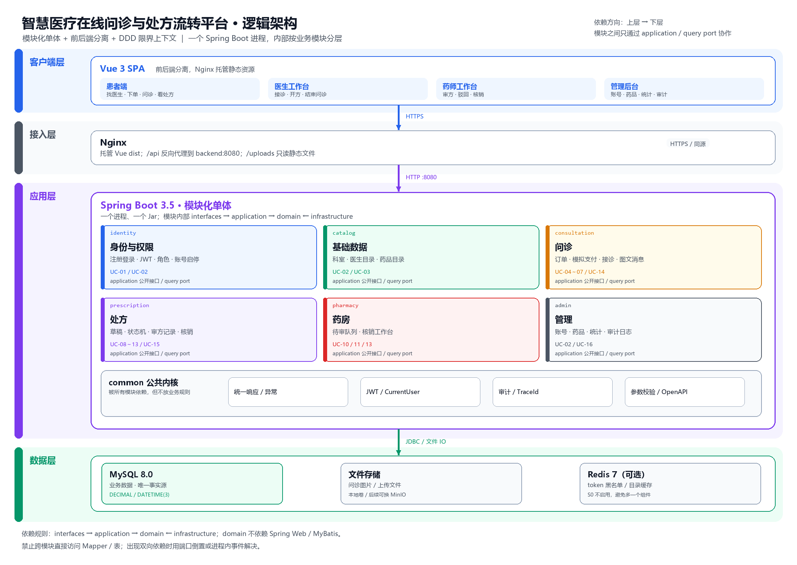
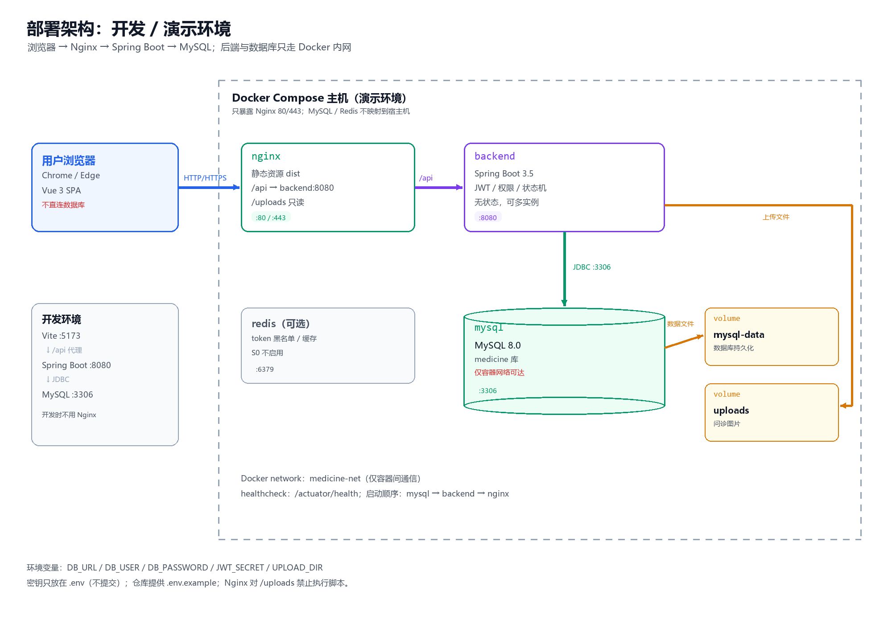
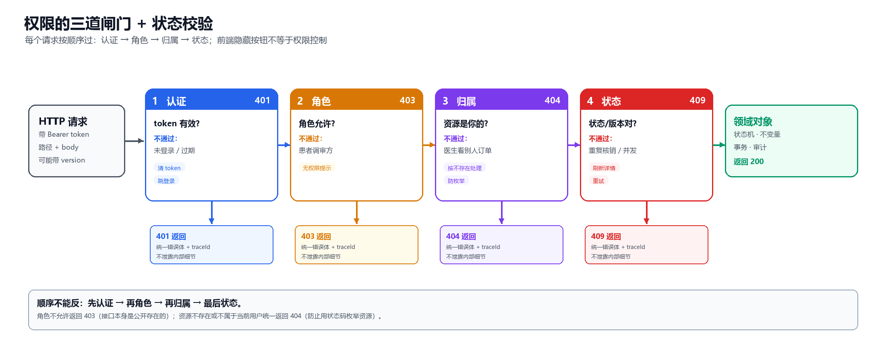

# 智慧医疗在线问诊与处方流转平台 · 系统设计规格说明书（架构与接口分册）

| 项 | 内容 |
|---|---|
| 版本 | v0.1（架构基线草案） |
| 日期 | 2026-10-26 |
| 编写 | 2号（架构与权限） |
| 输入 | 《需求规格说明书》v1.0（PR #2）、《软件工程实验》指导书 |
| 对应 | 实验二「系统设计与技术选型」；实验报告第 2 章 2.1 体系结构设计 |
| 状态 | 待组长与后端负责人评审，评审通过后作为 S0 的设计基线 |

> 阅读说明：本文只负责「系统怎么分层、模块怎么划分、前后端怎么约定接口、权限怎么拦」。
> 具体的类图、数据库字段清单、页面原型，分别由 3号（数据与领域模型）、4号（前端）、5号（后端）在各自文档中细化。
> 本文出现的接口与权限，是他们的共同约束；任何一方要改，先改本文并走 PR。

---

## 1 概述

### 1.1 目的

把需求基线中的 4 类角色、16 个用例、处方 6 状态 8 迁移，落成一套**6 人团队在 5 个 Sprint 内做得完、讲得清、能验收**的软件结构。具体回答四个问题：

1. 系统分成哪几层、哪几个模块，每个模块负责什么；
2. 模块之间允许谁调用谁，不允许什么；
3. 前后端通过什么接口、什么数据格式协作；
4. 谁在什么条件下能调用哪个接口，越权时返回什么。

### 1.2 范围

**本文覆盖：**

- 架构方案对比与选型、逻辑架构、物理架构；
- 模块边界、包结构、依赖规则；
- REST 接口通用规范、错误码、关键接口清单；
- RBAC + 数据归属 + 状态机三道权限闸门；
- 与权限相关的审计、并发、非功能需求落地。

**本文不覆盖：**

- 完整的数据库表字段、索引、SQL（3号负责，见《数据库设计说明书》）；
- 完整的类图、鲁棒图、时序图（3号/5号负责，本文只给关键协作）；
- 页面原型、组件拆分（4号负责）；
- 测试用例全集（6号负责，本文只给权限测试点）。

### 1.3 设计输入与硬约束

| 约束 | 来源 | 对设计的影响 |
|---|---|---|
| 4 类角色：患者、医生、药师、管理员 | 需求基线 2.1 | 权限模型必须按角色 + 数据归属 + 状态三层控制 |
| 16 个用例，处方 6 状态 8 迁移 | 需求基线 2.2、附录 A | 状态机放在领域层，迁移必须白名单化 |
| 6 人团队、5 个 Sprint、1–2 周/ Sprint | 需求基线 1.2 | 不做微服务，不做分布式事务，优先可演示的纵向链路 |
| JDK 21 + Spring Boot 3.5.x + MySQL 8 + Vue 3 + Node 22 | README、需求基线 | 后端单进程模块化单体，前端 SPA，Docker Compose 部署 |
| 课程要求 UML、分层架构、DDD 子域划分 | 实验指导书 | 必须能画出包图、部署图，并解释架构风格 |
| 不接真实支付、医保、视频；药品不扣库存 | 需求基线 1.1 | 支付、物流、库存不做领域建模，避免过度设计 |
| 医疗数据安全与隐私 | 需求基线 NFR-01/02/05 | JWT、BCrypt、最小权限、手机号脱敏、日志脱敏 |

---

## 2 架构决策与选型

### 2.1 候选方案对比

课程要求「至少分析两种以上的软件架构方案，分析不同方案对开发约束条件的支持程度，并进行方案选择」。结合本组 6 人、5 个 Sprint、以演示闭环为目标的实际情况，对比如下：

| 维度 | 方案 A：经典三层单体 | 方案 B：微服务 | 方案 C：模块化单体 + 前后端分离（选用） |
|---|---|---|---|
| 结构 | Controller → Service → Mapper，一个 Spring Boot 工程 | 按用户、问诊、处方、药房拆成独立服务，各自部署 | 一个 Spring Boot 进程，内部按限界上下文分模块，每个模块再分层 |
| 优点 | 上手最快、代码量最少、联调简单 | 边界强制、可独立扩容、故障隔离 | 边界清晰、部署简单、能体现 DDD 与分层、后续可拆 |
| 缺点 | 业务逻辑容易堆在 Service，权限与状态校验散落，模块边界靠自觉 | 分布式事务、网关、注册发现、链路追踪、运维成本高；6 人/5 Sprint 很难收尾 | 需要团队纪律：禁止跨模块直接访问 Mapper；否则退化成 A |
| 对课程要求的支撑 | 能画分层，但 DDD 子域不明显 | 架构图漂亮，但实现与测试压力大 | 能画包图/部署图，能讲清限界上下文与依赖倒置 |
| 对本项目的适用性 | 可用，但后期处方状态与权限容易失控 | 不适用：本期没有独立扩容与独立发布需求 | **最合适**：一个可执行 Jar + 一个前端 dist 即可演示 |

### 2.2 决策

采用 **方案 C：模块化单体（Modular Monolith）+ 前后端分离 + DDD 限界上下文**。

- **一个部署单元**：后端一个 Spring Boot 进程，前端一个 Vue 3 SPA；
- **六个业务模块**：identity（身份与权限）、catalog（基础数据）、consultation（问诊）、prescription（处方）、pharmacy（药房）、admin（管理）；
- **每个模块内部分四层**：interfaces → application → domain ← infrastructure；
- **模块之间**只通过 application 层的公开接口或 query port 协作，不直接依赖对方的 Controller、Mapper、Entity；
- **进程内事件**用于解耦副作用（如处方流转后通知问诊模块），不引入 MQ。

### 2.3 为什么不是微服务

1. **团队与周期**：6 人、5 个 Sprint，还要上课；微服务的网关、注册中心、配置中心、分布式事务、链路追踪会吃掉大部分时间。
2. **业务规模**：本期是课程演示系统，日活与数据量很小，没有独立扩容的真实需求。
3. **一致性**：处方状态、审方记录、审计日志需要强一致；单库本地事务最简单、最可验证。
4. **课程评分点**：老师看的是「有没有清晰的架构决策与 UML 表达」，不是「有没有拆成 8 个服务」。模块化单体同样能体现 DDD 子域与依赖规则。

### 2.4 代价与纪律

选择模块化单体，必须接受以下纪律，否则会退化成「大泥球」：

1. 禁止跨模块直接注入对方的 `Mapper`/`Repository` 实现；只能调用对方 `application` 包的公开服务或 `domain` 包暴露的 query port。
2. 禁止跨模块写表；每张表只有一个 owner 模块。
3. 禁止在 Controller 里写业务规则；状态迁移、权限归属校验放在 application/domain。
4. 模块间出现双向依赖时，用**端口倒置**或**领域事件**解决，不允许直接互相 import。
5. 每个模块的 `domain` 包不依赖 Spring Web、MyBatis、Redis 等基础设施。

### 2.5 何时可以拆成微服务

满足以下任一条件再考虑拆分，本期不拆：

- 某个模块需要独立扩容（如问诊消息量远大于其他模块）；
- 某个模块需要独立发布节奏（如药房对接外部系统）；
- 团队规模超过 10 人，模块 owner 可以独立成组；
- 出现明确的合规隔离要求（如处方数据必须独立存储）。

### 2.6 关键架构决策记录（ADR）

| 编号 | 决策 | 理由 | 代价 |
|---|---|---|---|
| ADR-001 | 模块化单体，不拆微服务 | 6 人/5 Sprint，强一致，部署简单 | 单进程故障域；需靠纪律与审查守住边界 |
| ADR-002 | 前后端分离，JWT 无状态认证 | Vue SPA 与 Spring Boot 解耦；易水平扩展 | 注销/封禁不能即时生效；用短有效期 + 后续 token version 缓解 |
| ADR-003 | 处方/订单状态迁移用乐观锁 | 两人同时审方/核销时只能成功一次 | 所有迁移接口必须带 `version`，前端要处理 409 |
| ADR-004 | 角色不匹配返回 403，资源不存在/不属于当前用户返回 404 | 同时满足「拒绝越权」与「不泄露资源是否存在」 | 前端不能靠 403/404 区分「没权限」与「没数据」 |
| ADR-005 | 金额用 JSON 字符串、数据库 DECIMAL(10,2) | 避免 JS 浮点误差；金额不参与复杂运算 | 前端展示直接使用字符串，计算时转 BigDecimal/整数分 |
| ADR-006 | 接口统一 `/api/v1` 前缀 | 预留版本演进空间；Nginx 按前缀转发 | 需要约定废弃策略，不能随意改字段 |

---

## 3 逻辑架构

### 3.1 分层结构

每个业务模块内部统一分四层，依赖方向固定：

| 层 | 职责 | 允许依赖 | 典型内容 |
|---|---|---|---|
| interfaces（接口层） | 接收 HTTP 请求、参数校验、组装 DTO、返回统一响应 | application | `*Controller`、`request/response DTO`、`Assembler` |
| application（应用层） | 编排用例、开启事务、调用领域对象、发布事件 | domain、common | `*AppService`、`*UseCase`、事务边界 |
| domain（领域层） | 业务规则、状态机、实体/值对象、仓储接口 | 仅 common 的最小子集 | `Prescription`、`OrderStatus`、`PrescriptionStateMachine`、`*Repository` 接口 |
| infrastructure（基础设施层） | 实现仓储、访问 MySQL/Redis/文件、外部网关 | domain、common | `*RepositoryImpl`、`*Mapper`、`*Gateway` |
| common（公共内核） | 统一响应、异常、错误码、JWT、当前用户、审计、配置 | 不依赖业务模块 | `ApiResponse`、`BizException`、`JwtTokenProvider`、`CurrentUser` |

**依赖规则（必须能通过代码审查）：**

```text
interfaces ──> application ──> domain
                    │              ▲
                    └──> common    │
infrastructure ────────────────────┘   （实现 domain 的仓储/网关接口）
```

- `domain` 不依赖 `interfaces`、`infrastructure`，也不依赖 Spring MVC；
- `application` 不直接写 SQL，只调用 `domain` 的仓储接口；
- `infrastructure` 的 `RepositoryImpl` 实现 `domain` 的接口，由 Spring 注入；
- `common` 不放业务规则，避免变成「万能工具包」。

### 3.2 限界上下文与模块职责

| 模块 | 子域类型 | 负责什么 | 拥有的数据 | 对应用例 | 对外暴露 |
|---|---|---|---|---|---|
| identity | 通用支撑域 | 注册、登录、JWT、角色、账号启停、当前用户 | `sys_user` | UC-01、UC-02（账号部分） | `AuthService`、`CurrentUser`、`UserQueryPort` |
| catalog | 通用支撑域 | 科室、医生目录、药品目录 | `department`、`doctor`、`drug` | UC-02（药品部分）、UC-03 | `DoctorQueryPort`、`DrugQueryPort` |
| consultation | 核心域 | 问诊订单、支付（模拟）、接诊/拒诊、图文消息、结束问诊 | `consultation_order`、`consultation_message` | UC-04～07、UC-14 | `ConsultationService`、`OrderQueryPort` |
| prescription | 核心域 | 处方草稿、明细、提交、状态机、审方记录、核销、作废 | `prescription`、`prescription_item`、`prescription_review` | UC-08～13、UC-15 | `PrescriptionService`、`PrescriptionQueryPort` |
| pharmacy | 支撑子域 | 药师待审队列、核销工作台；不重复实现处方规则 | 不单独建业务表（读处方模块） | UC-10、UC-11、UC-13 | `ReviewQueueQuery`、`DispenseAppService` |
| admin | 通用支撑域 | 账号管理、药品维护入口、统计、审计日志查询 | `audit_log`（统计走读模型） | UC-02、UC-16 | `AdminQueryPort`、`AuditQuery` |
| common | 技术内核 | 统一响应/异常/错误码、JWT、参数校验、审计切面、OpenAPI | 无业务表 | — | 被所有模块依赖 |

**为什么把「审方/核销」放在 pharmacy，而状态机放在 prescription？**

- 处方状态机是处方自己的不变量，必须和 `Prescription` 实体放在一起，不能散落在药师 Controller；
- pharmacy 只负责「药师工作台」的编排（待审队列、核销入口），具体迁移调用 `PrescriptionService` 的用例方法；
- 这样既体现药房是独立子域，又保证处方状态只有一个权威实现。

### 3.3 模块依赖规则

允许的依赖方向：

```text
identity        catalog
    \              /
     consultation
          |
     prescription
          |
       pharmacy

admin ──> 只读 query port（identity / catalog / consultation / prescription）
common <── 所有模块
```

具体规则：

1. `identity`、`catalog` 是上游，不依赖任何业务模块；
2. `consultation` 可以依赖 `identity`（患者/医生）、`catalog`（医生/科室）；
3. `prescription` 可以依赖 `identity`、`catalog`、`consultation` 的 **query port**（只读校验订单归属与状态）；
4. `pharmacy` 依赖 `prescription` 的 application 接口，不直接操作处方表；
5. `admin` 只依赖各模块的只读 query port，不写业务表；
6. **禁止 `consultation` 直接依赖 `prescription`**。结束问诊需要判断「是否已有已流转处方」时，用下面两种方式之一：
   - 由 `prescription` 在处方流转后发布进程内事件 `PrescriptionCirculatedEvent`，`consultation` 监听并更新订单的 `prescriptionReady` 标记；
   - 或在 `consultation` 定义 `PrescriptionGate` 接口，由 `prescription` 的 infrastructure 提供实现（端口倒置）。
   本期推荐事件方式，代码更直观，也方便以后加通知。

### 3.4 逻辑架构图



> PlantUML 源文件：`docs/diagrams/architecture-logical.puml`。如果图片无法显示，用 VS Code 的 PlantUML 插件打开源文件预览。

### 3.5 关键用例的模块协作

#### 3.5.1 医生提交处方（UC-09）

```text
DoctorController
  → PrescriptionAppService.submit(prescriptionId, doctorId, version)
    → 加载 Prescription（校验 owner=doctorId）
    → PrescriptionStateMachine.assertCanSubmit(status, items, version)
    → DrugQueryPort 校验药品为启用状态（catalog）
    → PrescriptionRepository.save(status=PENDING_REVIEW, version+1)
    → AuditRecorder.record(SUBMIT)
    → 发布 PrescriptionSubmittedEvent（通知药师队列）
```

关键点：

- 医生只能提交自己的处方：`prescription.doctorId == currentUserId`，否则 404；
- 提交前校验：诊断非空、明细 1–5 条、药品启用、状态为 `DRAFT` 或 `REJECTED`；
- 状态更新带 `version`，失败返回 409；
- 审计记录与状态更新在同一事务。

#### 3.5.2 药师审核通过（UC-10）

```text
PharmacyController
  → PrescriptionAppService.approve(prescriptionId, pharmacistId, version)
    → 加载 Prescription（状态必须 PENDING_REVIEW）
    → 校验当前用户角色为 PHARMACIST
    → 计算 validUntil = now + 3 天
    → 更新 status=CIRCULATED, validUntil, version+1
    → 写 prescription_review（APPROVED）
    → 写 audit_log
    → 发布 PrescriptionCirculatedEvent
```

#### 3.5.3 药师核销（UC-13）

```text
PharmacyController
  → PrescriptionAppService.dispense(prescriptionId, pharmacistId, version)
    → 状态必须 CIRCULATED
    → now <= validUntil，否则 409（已过期，应先由定时任务置为 CANCELLED）
    → 更新 status=DISPENSED, version+1
    → 写 audit_log
```

### 3.6 S0 代码骨架

S0 只要求「能登录、能按角色进工作台、统一响应、权限骨架」，不要求实现全部业务。包结构先立起来，后续增量往里填：

```text
com.medicine.platform
├── common
│   ├── api          ApiResponse, PageResponse, ErrorCode
│   ├── exception    BizException, GlobalExceptionHandler
│   ├── security     SecurityConfig, JwtTokenProvider, JwtAuthenticationFilter,
│   │                CurrentUser, PermissionChecker
│   ├── audit        AuditRecorder, AuditEvent
│   └── config       JacksonConfig, WebMvcConfig, OpenApiConfig
├── identity
│   ├── interfaces   AuthController, AdminUserController, dto
│   ├── application  AuthAppService, UserAdminAppService
│   ├── domain       User, Role, UserStatus, UserRepository, UserQueryPort
│   └── infrastructure UserRepositoryImpl, UserMapper
├── catalog
│   ├── interfaces   DepartmentController, DoctorController, DrugController
│   ├── application  DoctorQueryService, DrugAppService
│   ├── domain       Department, Doctor, Drug, DoctorQueryPort, DrugQueryPort
│   └── infrastructure ...
├── consultation
│   ├── interfaces   ConsultationOrderController, MessageController
│   ├── application  ConsultationOrderAppService, MessageAppService
│   ├── domain       ConsultationOrder, Message, OrderStatus, OrderRepository
│   └── infrastructure ...
├── prescription
│   ├── interfaces   PrescriptionController
│   ├── application  PrescriptionAppService
│   ├── domain       Prescription, PrescriptionItem, PrescriptionStatus,
│   │                PrescriptionStateMachine, PrescriptionRepository
│   └── infrastructure ...
├── pharmacy
│   ├── interfaces   PharmacyController
│   ├── application  ReviewQueueAppService, DispenseAppService
│   ├── domain       ReviewQueueQuery
│   └── infrastructure ...
└── admin
    ├── interfaces   AdminStatsController, AuditLogController
    ├── application  StatsQueryService, AuditQueryService
    ├── domain       StatsQueryPort, AuditQueryPort
    └── infrastructure ...
```

**S0 的验收边界：**

- `common` 的统一响应、异常、错误码、JWT、`CurrentUser` 可用；
- `identity` 的登录、`/auth/me`、按角色返回菜单可用；
- `catalog` 的科室/医生查询可返回种子数据；
- 其余模块只建包与 `package-info.java`，不写空 Controller；
- 数据库只建 `sys_user`（S0 增量），其余表按 Sprint 增量创建。

### 3.7 依赖检查

- 代码审查时检查：`domain` 是否 import 了 `org.springframework.web`、`org.apache.ibatis`；
- 模块间是否直接 import 了对方的 `infrastructure` 或 `mapper`；
- 后续可加 ArchUnit 测试，例如「prescription 的 domain 不能依赖 pharmacy」；S0 先靠审查清单，S1 再补测试。

---

## 4 物理架构

### 4.1 部署图



> PlantUML 源文件：`docs/diagrams/architecture-deployment.puml`。

### 4.2 节点与端口

| 节点 | 组件 | 端口 | 职责 |
|---|---|---|---|
| 用户浏览器 | Chrome / Edge | — | 访问 SPA；不直连数据库 |
| Web 服务器 | Nginx | 80/443 | 托管 Vue `dist`；`/api` 反向代理到后端；`/uploads` 静态文件 |
| 应用服务器 | Spring Boot 3.5（Docker） | 8080 | 认证、业务用例、权限、审计 |
| 数据库 | MySQL 8.0（Docker） | 3306 | 业务数据；仅容器网络可达 |
| 缓存（可选） | Redis 7（Docker） | 6379 | 后续 token 黑名单、医生目录缓存；S0 不启用 |
| 文件卷 | Docker volume / 本地目录 | — | 问诊图片、上传文件；不存数据库 |

### 4.3 环境变量

| 变量 | 示例 | 说明 |
|---|---|---|
| `SPRING_DATASOURCE_URL` | `jdbc:mysql://mysql:3306/medicine?useUnicode=true&characterEncoding=utf8&serverTimezone=Asia/Shanghai` | 容器内用服务名 `mysql` |
| `SPRING_DATASOURCE_USERNAME` | `medicine` | 不用 root 连接业务 |
| `SPRING_DATASOURCE_PASSWORD` | 由 `.env` 注入 | 不提交到 Git |
| `JWT_SECRET` | 至少 32 字节随机串 | 不提交到 Git；`.env.example` 只放占位符 |
| `JWT_EXPIRE_MINUTES` | `120` | 与需求 NFR-01 一致 |
| `UPLOAD_DIR` | `/app/uploads` | 挂载到 volume |
| `TZ` | `Asia/Shanghai` | 统一时区 |

### 4.4 开发环境与演示环境

| 环境 | 前端 | 后端 | 数据库 | 启动方式 |
|---|---|---|---|---|
| 开发 | Vite `http://localhost:5173` | `http://localhost:8080` | `localhost:3306` | 分别 `npm run dev`、`mvn spring-boot:run` |
| 演示 | Nginx `http://localhost` | 容器内 `backend:8080` | 容器内 `mysql:3306` | `docker compose up -d` |

开发环境用 Vite 代理 `/api` 到 8080，避免 CORS；演示环境同源，不需要 CORS。若确实要跨域，只允许配置的前端 Origin，不用 `*`。

### 4.5 安全边界

- MySQL 端口不映射到宿主机（演示环境），只暴露给 Docker 网络；
- Nginx 只开放 80/443；后端 8080 不直接对公网；
- `.env`、`application-prod.yml` 不提交；仓库只提供 `.env.example`；
- 上传目录禁止执行脚本，Nginx 对 `/uploads` 只读；
- 生产/演示环境启用 HTTPS；课程本地演示可先用 HTTP，但报告里要说明差异。

### 4.6 可扩展性

- 后端无状态（JWT），将来可在 Nginx 后挂多个实例；
- 文件存储可换 MinIO/OSS，不影响业务代码；
- 若问诊消息量增大，可把消息模块拆出并引入 WebSocket/MQ；
- 本期不引入 Redis，避免多一个组件要装、要讲、要排错。

---

## 5 接口规范

### 5.1 基本原则

1. **契约先行**：先定本文的接口清单与字段，再写 Controller；前后端按同一份契约开发。
2. **资源导向**：URL 用名词复数，动作用子资源或动词后缀（状态迁移用 `POST .../submit` 这类明确动作）。
3. **版本化**：统一 `/api/v1`；破坏性变更升 `/api/v2`，不在 v1 里偷偷改字段含义。
4. **一致错误**：所有错误返回同一结构，前端只写一套错误处理。
5. **状态迁移幂等**：同一 `version` 重复提交只成功一次，第二次返回 409，不重复写审计。
6. **不泄露**：错误信息不回传 SQL、堆栈、其他患者信息；日志不打印密码/token。

### 5.2 通用约定

| 项 | 约定 |
|---|---|
| Base URL | `/api/v1` |
| 协议/编码 | HTTPS（演示可 HTTP）；`Content-Type: application/json; charset=UTF-8` |
| JSON 命名 | lowerCamelCase，例如 `doctorId`、`createdAt`；数据库用 snake_case |
| ID | 后端 `Long`，JSON 一律输出字符串，避免 JS 精度丢失；请求可传字符串或数字 |
| 金额 | JSON 字符串，单位元，两位小数，例如 `"49.00"`；后端 `BigDecimal`，DB `DECIMAL(10,2)` |
| 时间 | ISO 8601 带时区，例如 `2026-10-26T18:43:11+08:00`；DB `DATETIME(3)`，统一 Asia/Shanghai |
| 空值 | 列表返回 `[]` 不返回 `null`；可选对象无值时返回 `null`；请求不传表示不修改 |
| 认证 | `Authorization: Bearer <JWT>` |
| 追踪 | 响应带 `traceId`；后端日志带同一 `traceId` |
| 分页 | `page` 从 1 开始，`size` 默认 20、最大 100 |
| 排序 | `sort=createdAt,desc`；只允许白名单字段 |
| 过滤 | 明确参数名，例如 `status=PENDING_REVIEW&departmentId=3` |

### 5.3 统一响应

**成功：**

```json
{
  "code": 0,
  "message": "ok",
  "data": {
    "id": "1001",
    "status": "PENDING_REVIEW"
  },
  "traceId": "b7c3f0d2e8a14f6c"
}
```

**失败：**

```json
{
  "code": 40901,
  "message": "处方状态已变化，请刷新后重试",
  "data": {
    "currentStatus": "CIRCULATED",
    "currentVersion": 4
  },
  "traceId": "b7c3f0d2e8a14f6c"
}
```

**校验失败：**

```json
{
  "code": 40001,
  "message": "参数校验失败",
  "data": {
    "fields": {
      "description": "病情描述长度需在 10–500 字之间"
    }
  },
  "traceId": "b7c3f0d2e8a14f6c"
}
```

约定：

- `code=0` 表示成功；非 0 为业务错误码；
- HTTP 状态码仍要正确（400/401/403/404/409/500），不能所有错误都返回 200；
- `message` 是给用户看的中文，不暴露内部异常；
- `data` 失败时可为 `null` 或带补充信息（如当前状态、字段错误）。

### 5.4 HTTP 状态码与业务错误码

| HTTP | 含义 | 典型业务码 | 前端动作 |
|---|---|---|---|
| 200 | 查询/更新成功 | 0 | 正常处理 |
| 201 | 创建成功 | 0 | 取 `data.id` |
| 204 | 删除/注销成功 | — | 不读 body |
| 400 | 参数校验失败 | 40001 | 展示字段错误 |
| 401 | 未登录/token 过期 | 40101 | 清 token，跳登录 |
| 403 | 已登录但角色不允许 | 40301 | 展示「无权限」 |
| 404 | 资源不存在或不属于当前用户 | 40401 | 展示「未找到」 |
| 409 | 状态冲突/版本冲突/重复操作 | 40901/40902 | 刷新详情，提示重试 |
| 429 | 请求过于频繁（可选） | 42901 | 稍后再试 |
| 500 | 服务器内部错误 | 50000 | 展示通用错误，带 traceId |

业务码分段建议：

| 段 | 用途 |
|---|---|
| `0` | 成功 |
| `400xx` | 参数/校验 |
| `401xx` | 认证 |
| `403xx` | 授权 |
| `404xx` | 资源不存在 |
| `409xx` | 状态/并发/重复 |
| `500xx` | 系统错误 |

### 5.5 认证接口

#### 5.5.1 注册

`POST /api/v1/auth/register`（公开）

```json
{
  "phone": "13800138000",
  "password": "Passw0rd!",
  "name": "张三"
}
```

规则：

- **公开注册只能创建患者**；服务端固定 `role=PATIENT`，请求体不接收 `role`；
- 手机号唯一；密码至少 8 位，含字母和数字；
- 密码 BCrypt 存储；返回 201，不返回密码摘要；
- 医生/药师/管理员账号只能由管理员通过 `POST /api/v1/admin/users` 创建。

#### 5.5.2 登录

`POST /api/v1/auth/login`（公开）

```json
{
  "phone": "13800138000",
  "password": "Passw0rd!"
}
```

响应：

```json
{
  "code": 0,
  "message": "ok",
  "data": {
    "token": "eyJhbGciOiJIUzI1NiJ9...",
    "expiresIn": 7200,
    "user": {
      "id": "1001",
      "name": "张三",
      "role": "PATIENT"
    }
  },
  "traceId": "..."
}
```

#### 5.5.3 当前用户

`GET /api/v1/auth/me`（需登录）

返回 `id`、`name`、`role`、`phoneMasked`、`status`。不返回密码摘要、身份证等敏感字段。

#### 5.5.4 注销

`POST /api/v1/auth/logout`（需登录）

本期无服务端会话，注销由前端清除 token；接口返回 204 仅用于记录审计。若后续需要即时失效，增加 `tokenVersion` 或 Redis 黑名单。

### 5.6 分页、排序、过滤

请求：

```http
GET /api/v1/prescriptions?status=PENDING_REVIEW&page=1&size=20&sort=createdAt,asc
```

响应：

```json
{
  "code": 0,
  "message": "ok",
  "data": {
    "items": [],
    "page": 1,
    "size": 20,
    "total": 0
  },
  "traceId": "..."
}
```

规则：

- `size > 100` 按 100 处理或返回 400；
- `sort` 只允许 `createdAt`、`updatedAt`、`status` 等白名单字段，防止 SQL 注入；
- 列表默认不返回大字段（如消息内容、处方明细），详情接口再查。

### 5.7 并发与幂等

- 所有状态迁移请求体必须带 `version`（整数），例如：

```json
{
  "version": 3,
  "reason": "诊断需要补充"
}
```

- 服务端执行 `UPDATE ... WHERE id=? AND status=? AND version=?`，影响行数为 0 返回 409；
- 409 的 `data` 带 `currentStatus`、`currentVersion`，前端刷新后让用户重试；
- 支付接口可选 `Idempotency-Key` 请求头，24 小时内相同 key 返回首次结果；本期若不做，至少用订单状态 + 唯一约束防止重复支付。

### 5.8 接口清单

> 权限列的含义：`公开` 不需要 token；`登录` 只要求已登录；`PATIENT`/`DOCTOR`/`PHARMACIST`/`ADMIN` 表示角色；`owner` 表示还要校验数据归属；`state` 表示还要校验状态机。
> Sprint 列表示该接口最早在哪个增量交付。

#### 5.8.1 认证与账号

| 方法 | 路径 | 权限 | 说明 | Sprint |
|---|---|---|---|---|
| POST | `/auth/register` | 公开 | 患者注册，服务端固定 PATIENT | S0 |
| POST | `/auth/login` | 公开 | 登录，返回 JWT | S0 |
| GET | `/auth/me` | 登录 | 当前用户信息 | S0 |
| POST | `/auth/logout` | 登录 | 注销（客户端清 token） | S0 |
| GET | `/admin/users` | ADMIN | 账号列表 | S1 |
| POST | `/admin/users` | ADMIN | 创建医生/药师/管理员 | S1 |
| PATCH | `/admin/users/{id}/status` | ADMIN | 启用/停用账号 | S1 |

#### 5.8.2 基础数据

| 方法 | 路径 | 权限 | 说明 | Sprint |
|---|---|---|---|---|
| GET | `/departments` | 登录 | 科室列表 | S0 |
| GET | `/doctors` | 登录 | 按科室分页查医生 | S1 |
| GET | `/doctors/{id}` | 登录 | 医生详情 | S1 |
| GET | `/drugs` | DOCTOR/ADMIN | 药品目录查询 | S2 |
| POST | `/admin/drugs` | ADMIN | 新增药品 | S2 |
| PUT | `/admin/drugs/{id}` | ADMIN | 修改药品/启停 | S2 |

#### 5.8.3 问诊订单与消息

| 方法 | 路径 | 权限 | 说明 | Sprint |
|---|---|---|---|---|
| POST | `/consultation-orders` | PATIENT | 创建订单（待支付） | S1 |
| POST | `/consultation-orders/{id}/pay` | PATIENT owner | 模拟支付 | S1 |
| POST | `/consultation-orders/{id}/accept` | DOCTOR owner | 接诊 | S1 |
| POST | `/consultation-orders/{id}/reject` | DOCTOR owner | 拒诊，填理由 | S1 |
| GET | `/consultation-orders` | 登录 | 患者看自己/医生看接诊/管理员看全部 | S1 |
| GET | `/consultation-orders/{id}` | owner 或 ADMIN | 订单详情 | S1 |
| POST | `/consultation-orders/{id}/end` | DOCTOR owner state | 结束问诊 | S4 |
| GET | `/consultation-orders/{id}/messages` | owner | 消息列表 | S2 |
| POST | `/consultation-orders/{id}/messages` | owner state | 发送文字/图片 | S2 |

#### 5.8.4 处方与药房

| 方法 | 路径 | 权限 | 说明 | Sprint |
|---|---|---|---|---|
| POST | `/consultation-orders/{orderId}/prescriptions` | DOCTOR owner state | 创建处方草稿 | S2 |
| PUT | `/prescriptions/{id}` | DOCTOR owner state | 修改草稿/驳回后修改 | S2/S3 |
| GET | `/prescriptions/{id}` | owner/PHARMACIST/ADMIN | 处方详情 + 状态时间线 | S2 |
| GET | `/prescriptions` | 登录 | 患者自己/医生自己/药师队列 | S2 |
| POST | `/prescriptions/{id}/submit` | DOCTOR owner state | 提交审核（DRAFT/REJECTED） | S2 |
| POST | `/prescriptions/{id}/approve` | PHARMACIST state | 审核通过 | S3 |
| POST | `/prescriptions/{id}/reject` | PHARMACIST state | 驳回，理由 ≥10 字 | S3 |
| POST | `/prescriptions/{id}/dispense` | PHARMACIST state | 核销发药 | S4 |
| POST | `/prescriptions/{id}/cancel` | DOCTOR owner / ADMIN state | 作废（草稿/强制作废） | S3/S4 |

#### 5.8.5 管理

| 方法 | 路径 | 权限 | 说明 | Sprint |
|---|---|---|---|---|
| GET | `/admin/stats/overview` | ADMIN | 订单量、处方量、驳回率、核销率 | S4 |
| GET | `/admin/audit-logs` | ADMIN | 审计日志查询 | S4 |

### 5.9 关键接口示例

#### 5.9.1 创建问诊订单

`POST /api/v1/consultation-orders`

```json
{
  "doctorId": "2001",
  "description": "反复咳嗽三天，无发热，想咨询是否需要拍片。"
}
```

响应 201：

```json
{
  "code": 0,
  "message": "ok",
  "data": {
    "id": "3001",
    "orderNo": "CO202610260001",
    "status": "PENDING_PAYMENT",
    "fee": "49.00",
    "version": 0,
    "createdAt": "2026-10-26T18:43:11+08:00"
  },
  "traceId": "..."
}
```

#### 5.9.2 提交处方审核

`POST /api/v1/prescriptions/4001/submit`

```json
{
  "version": 2
}
```

响应 200：

```json
{
  "code": 0,
  "message": "ok",
  "data": {
    "id": "4001",
    "status": "PENDING_REVIEW",
    "version": 3,
    "submittedAt": "2026-10-26T19:02:00+08:00"
  },
  "traceId": "..."
}
```

冲突 409：

```json
{
  "code": 40901,
  "message": "处方状态已变化，请刷新后重试",
  "data": {
    "currentStatus": "CIRCULATED",
    "currentVersion": 4
  },
  "traceId": "..."
}
```

#### 5.9.3 药师驳回

`POST /api/v1/prescriptions/4001/reject`

```json
{
  "version": 3,
  "reason": "阿莫西林与患者过敏史冲突，请更换药品。"
}
```

规则：理由 ≥10 字；状态必须 `PENDING_REVIEW`；成功后状态 `REJECTED`，写 `prescription_review` 与 `audit_log`。

#### 5.9.4 核销

`POST /api/v1/prescriptions/4001/dispense`

```json
{
  "version": 5
}
```

规则：状态 `CIRCULATED`；`now <= validUntil`；重复核销返回 409；成功后状态 `DISPENSED`。

### 5.10 变更管理

- 任何字段增删、枚举值变化、路径变化，都算契约变更，必须走 PR；
- 破坏性变更：升 `/api/v2`，或前后端同一 Sprint 内同步上线并在 PR 描述里写清影响；
- 新增字段：向后兼容，前端忽略未知字段；
- 后端用 springdoc 生成 OpenAPI，但**以本文档的清单为准**；生成结果与本文不一致时，先改本文再改代码；
- 每个 Sprint 评审前，2号检查一次「文档—代码—前端调用」三处是否一致。

### 5.11 前后端协作约定

1. 前端不拼 URL，统一放在 `src/api/`，按模块分文件；
2. 统一 axios 拦截器：注入 token、处理 401、把 `code!=0` 转成业务异常、带 `traceId` 提示；
3. 日期直接展示后端字符串，不做 `new Date()` 再格式化，避免时区偏移；
4. 金额按字符串展示；需要计算时转整数分；
5. 枚举值前端只用后端返回的字符串，不在前端硬编码中文；
6. 前端路由守卫只是体验优化，**真正的权限在后端**；
7. 联调前先用本文的 mock 数据，减少「字段名对不上」的返工。

---

## 6 权限设计

### 6.1 目标与原则

- **最小权限**：默认拒绝，只放行明确需要的角色；
- **纵深防御**：Controller 角色校验 + application 归属校验 + domain 状态校验，三层都要有；
- **不泄露**：不存在的资源与无权访问的资源，对外表现一致；
- **可审计**：关键动作（审方、核销、强制作废、账号启停）必须留痕；
- **前端不作为安全边界**：隐藏按钮只是 UX，不能替代后端校验。

### 6.2 三道闸门



> PlantUML 源文件：`docs/diagrams/permission-gates.puml`。

一次请求的检查顺序：

1. **认证（401）**：有没有 token、token 是否有效、是否过期；
2. **角色（403）**：当前角色是否允许调用这个接口/动作；
3. **归属（404）**：资源是否存在、是否属于当前用户（患者本人/接诊医生）；
4. **状态（409）**：当前状态是否允许这个迁移、`version` 是否匹配。

顺序不能反：先认证，再角色，再归属，最后状态。否则会把「资源存在」泄露给无权限的人。

### 6.3 角色与权限码

| 角色 | 编码 | 能做什么 | 不能做什么 |
|---|---|---|---|
| 患者 | `PATIENT` | 注册登录、浏览医生、下单支付、图文问诊、查看自己的订单与处方 | 审方、核销、看别人的订单、开方 |
| 医生 | `DOCTOR` | 接诊/拒诊、图文问诊、开方/改方/提交、查看自己接诊的订单、结束问诊 | 审方、核销、看其他医生的订单、管理账号 |
| 药师 | `PHARMACIST` | 查看待审队列、审核通过/驳回、核销 | 开方、改方、接诊、管理账号 |
| 管理员 | `ADMIN` | 账号管理、药品/科室维护、统计、审计日志、强制作废 | 代替医生开方、代替药师审方/核销 |

权限码（后端 `@PreAuthorize` 或自定义注解使用）：

```text
auth:login                 公开
user:profile:read          登录
user:profile:update        登录
catalog:doctor:read        登录
catalog:doctor:manage      ADMIN
catalog:drug:read          DOCTOR, ADMIN
catalog:drug:manage        ADMIN
consultation:order:create  PATIENT
consultation:order:pay     PATIENT + owner
consultation:order:read    owner / ADMIN
consultation:order:accept  DOCTOR + owner
consultation:order:reject  DOCTOR + owner
consultation:order:end     DOCTOR + owner + state
consultation:message:send  owner + state
prescription:create        DOCTOR + owner + state
prescription:update        DOCTOR + owner + state
prescription:submit        DOCTOR + owner + state
prescription:review        PHARMACIST + state
prescription:dispense      PHARMACIST + state
prescription:cancel        DOCTOR + owner / ADMIN + state
admin:account:manage       ADMIN
admin:stats:read           ADMIN
admin:audit:read           ADMIN
```

### 6.4 接口权限矩阵

图例：✓ 允许；— 不允许；△ 允许但受数据归属/状态限制。

| 接口 | 患者 | 医生 | 药师 | 管理员 |
|---|---|---|---|---|
| `POST /auth/register` | ✓ | ✓ | ✓ | ✓ |
| `POST /auth/login` | ✓ | ✓ | ✓ | ✓ |
| `GET /auth/me` | ✓ | ✓ | ✓ | ✓ |
| `GET /departments` | ✓ | ✓ | ✓ | ✓ |
| `GET /doctors` | ✓ | ✓ | ✓ | ✓ |
| `GET /drugs` | — | ✓ | — | ✓ |
| `POST /consultation-orders` | ✓ | — | — | — |
| `POST /consultation-orders/{id}/pay` | △ owner | — | — | — |
| `POST /consultation-orders/{id}/accept` | — | △ owner | — | — |
| `POST /consultation-orders/{id}/reject` | — | △ owner | — | — |
| `GET /consultation-orders` | △ 自己 | △ 自己接诊 | — | ✓ 全部 |
| `GET /consultation-orders/{id}` | △ owner | △ owner | — | ✓ |
| `POST /consultation-orders/{id}/end` | — | △ owner+state | — | — |
| `GET /consultation-orders/{id}/messages` | △ owner | △ owner | — | — |
| `POST /consultation-orders/{id}/messages` | △ owner+state | △ owner+state | — | — |
| `POST /consultation-orders/{orderId}/prescriptions` | — | △ owner+state | — | — |
| `PUT /prescriptions/{id}` | — | △ owner+state | — | — |
| `POST /prescriptions/{id}/submit` | — | △ owner+state | — | — |
| `POST /prescriptions/{id}/approve` | — | — | △ state | — |
| `POST /prescriptions/{id}/reject` | — | — | △ state | — |
| `POST /prescriptions/{id}/dispense` | — | — | △ state | — |
| `POST /prescriptions/{id}/cancel` | — | △ owner（草稿） | — | △ 强制作废 |
| `GET /prescriptions/{id}` | △ owner | △ owner | △ 待审/已流转 | ✓ |
| `GET /prescriptions` | △ 自己 | △ 自己 | △ 队列 | ✓ |
| `GET /admin/**` | — | — | — | ✓ |

> 完整矩阵以本文与 `权限矩阵.md` 为准；新增接口必须先在矩阵里加一行，再写代码。

### 6.5 数据归属规则

| 角色 | 数据范围 | 实现要点 |
|---|---|---|
| 患者 | `patient_id = currentUserId` | 查询条件强制拼当前用户；详情用 `findByIdAndPatientId` |
| 医生 | `doctor_id = currentDoctorId` | `currentDoctorId` 由 `user_id` 查医生表得到，不能由前端传 |
| 药师 | 状态为 `PENDING_REVIEW` 或 `CIRCULATED` 的处方；患者信息最小化 | 队列按状态过滤；详情不展示无关的病情隐私 |
| 管理员 | 全部数据，但临床内容只读 | 强制作废必须填理由并写审计；不能改诊断/药品明细 |

**关键：** `doctorId`、`patientId`、`role` 一律从 JWT/当前用户上下文取，**绝不信任请求体里的这些字段**。前端传了也忽略。

### 6.6 状态机权限表

处方状态：`DRAFT`（待开具）、`PENDING_REVIEW`（待审核）、`REJECTED`（已驳回）、`CIRCULATED`（已流转）、`DISPENSED`（已核销）、`CANCELLED`（已作废）。

| 迁移 | 源 → 目标 | 动作 | 允许角色 | 前置条件 | 副作用 | 失败码 |
|---|---|---|---|---|---|---|
| T1 | DRAFT → PENDING_REVIEW | 提交审核 | 医生（开方人） | 诊断非空；明细 1–5 条；药品启用；version 匹配 | 记录提交时间；进入药师队列；审计 | 400/404/409 |
| T2 | PENDING_REVIEW → CIRCULATED | 审核通过 | 药师 | 状态匹配；version 匹配 | 写审方记录；`validUntil=now+3d`；审计；发事件 | 404/409 |
| T3 | PENDING_REVIEW → REJECTED | 审核驳回 | 药师 | 理由 ≥10 字；version 匹配 | 写审方记录；记录理由；审计 | 400/409 |
| T4 | REJECTED → PENDING_REVIEW | 修改后重提 | 医生（开方人） | 修改后仍满足 T1；version 匹配 | 重新入队；审计 | 400/404/409 |
| T5 | DRAFT → CANCELLED | 作废草稿 | 医生（开方人） | 填理由；version 匹配 | 审计 | 400/409 |
| T6 | CIRCULATED → DISPENSED | 核销 | 药师 | `now <= validUntil`；version 匹配 | 记录核销人/时间；审计；订单可结束 | 409 |
| T7 | CIRCULATED → CANCELLED | 过期作废 | SYSTEM | `now > validUntil` | 审计（系统） | — |
| T8 | PENDING_REVIEW → CANCELLED | 强制作废 | 管理员 | 填理由；version 匹配 | 审计（必须） | 400/409 |

实现要求：

- 迁移白名单写在 `PrescriptionStateMachine`，**不能只靠 Controller 注解**；
- 每个迁移一个 application 方法，方法内加载聚合、校验状态、执行更新、写审计；
- 更新 SQL 必须带 `status` 与 `version`，影响行数 0 → 409；
- T7 由定时任务调用，日志标注 `actor=SYSTEM`；
- T8 只有管理员可调用，且必须留下理由，审计不可删。

### 6.7 401 / 403 / 404 / 409 的语义

这是本项目最容易做错、也最容易被老师问的地方，统一如下：

| 场景 | HTTP | 业务码 | 说明 |
|---|---|---|---|
| 没带 token、token 伪造/过期 | 401 | 40101 | 前端清 token，跳登录 |
| 已登录，但角色不允许调用该接口（患者调审方） | 403 | 40301 | 明确告诉「无权限」，因为接口本身是公开存在的 |
| 资源不存在 | 404 | 40401 | 不区分「真没有」还是「不是你的」 |
| 资源存在，但不属于当前用户（医生看别人订单） | 404 | 40401 | 与上一条一致，防止枚举 |
| 状态不允许（已核销又核销） | 409 | 40901 | `data` 带当前状态 |
| `version` 不匹配（两人同时审方） | 409 | 40902 | `data` 带当前版本 |
| 参数不合法 | 400 | 40001 | 字段级错误 |

> 需求 NFR-01 原文写「越权访问统一返回 403 且不泄露资源是否存在」。这两件事在严格意义上冲突：如果「存在但无权」返回 403、「不存在」返回 404，攻击者就能枚举资源。本文按 ADR-004 拆分为：**角色不允许 → 403；资源不属于你 → 404**。建议在需求文档 NFR-01 中同步修订这句话。

### 6.8 JWT 与密码

| 项 | 约定 |
|---|---|
| 密码存储 | BCrypt，cost 10–12；禁止 MD5/SHA1/明文 |
| JWT 算法 | HS256；密钥从 `JWT_SECRET` 环境变量读取，至少 32 字节 |
| Claims | `sub`=userId、`role`、`name`（可选）、`iat`、`exp`、`jti` |
| 有效期 | 2 小时（与 NFR-01 一致）；本期不做 refresh token |
| 注销 | 前端清 token；服务端记录审计。需要即时失效时加 `tokenVersion` 或 Redis 黑名单 |
| 传输 | 仅 HTTPS（演示可 HTTP）；不放 URL query |
| 日志 | 不打印 token、密码、Authorization 头 |
| 前端存储 | 存 `sessionStorage` 优先，降低 XSS 持久化风险；不做「记住我」 |

### 6.9 实现方式（S0 骨架）

```java
// common/security/CurrentUser.java
public record CurrentUser(Long userId, Role role, String name) {}

// common/security/PermissionChecker.java
@Component
public class PermissionChecker {
    public void requireRole(CurrentUser user, Role... allowed) {
        if (Arrays.stream(allowed).noneMatch(r -> r == user.role())) {
            throw new BizException(ErrorCode.FORBIDDEN);
        }
    }
}
```

Controller 只做「角色 + 参数」：

```java
@PostMapping("/prescriptions/{id}/approve")
@PreAuthorize("hasRole('PHARMACIST')")
public ApiResponse<PrescriptionVO> approve(
        @PathVariable Long id,
        @RequestBody @Valid ApproveRequest req,
        @AuthenticationPrincipal CurrentUser user) {
    return ApiResponse.ok(prescriptionAppService.approve(id, user, req.version()));
}
```

Application 做「归属 + 状态」：

```java
@Transactional
public PrescriptionVO approve(Long id, CurrentUser user, int version) {
    Prescription p = repository.findById(id)
        .orElseThrow(() -> new BizException(ErrorCode.NOT_FOUND));
    // 药师没有「归属」概念，但状态必须由领域对象校验
    p.approve(user.userId(), version); // 内部校验状态/版本，失败抛 409
    repository.save(p);
    reviewRepository.save(ReviewRecord.approved(p, user.userId()));
    auditRecorder.record(...);
    eventPublisher.publishEvent(new PrescriptionCirculatedEvent(p.id()));
    return assembler.toVO(p);
}
```

医生侧归属示例：

```java
Prescription p = repository.findByIdAndDoctorId(id, currentDoctorId)
    .orElseThrow(() -> new BizException(ErrorCode.NOT_FOUND)); // 别人的处方也返回 404
```

### 6.10 权限测试用例（交给 6号）

| 编号 | 场景 | 请求 | 期望 |
|---|---|---|---|
| SEC-01 | 患者调用审方 | `POST /prescriptions/1/approve`，患者 token | 403 |
| SEC-02 | 医生 A 看医生 B 的订单 | `GET /consultation-orders/{B的订单}`，A token | 404 |
| SEC-03 | 患者 A 看患者 B 的处方 | `GET /prescriptions/{B的处方}`，A token | 404 |
| SEC-04 | 过期处方核销 | `POST /prescriptions/{过期}/dispense` | 409 |
| SEC-05 | 两人同时审核通过 | 两个药师同 version 调用 approve | 一个 200，一个 409 |
| SEC-06 | 公开注册伪造 role | `POST /auth/register` 带 `"role":"ADMIN"` | 忽略 role，仍为 PATIENT |
| SEC-07 | 无 token 访问受保护接口 | `GET /auth/me` 无 Authorization | 401 |
| SEC-08 | 管理员强制作废 | `POST /prescriptions/{id}/cancel`，理由为空 | 400；有理由则 200 且审计有记录 |
| SEC-09 | 医生改别人的处方 | `PUT /prescriptions/{B的}` | 404 |
| SEC-10 | 药师核销后再次核销 | 同一处方重复 dispense | 409 |

### 6.11 权限审查清单（每个 PR 必看）

- [ ] 新接口是否在权限矩阵中登记？
- [ ] 是否从当前用户上下文取 `userId/role/doctorId`，而不是请求体？
- [ ] 查询是否带归属条件（`patient_id`/`doctor_id`）？
- [ ] 状态迁移是否走领域状态机，是否带 `version`？
- [ ] 失败是否返回正确的 401/403/404/409，而不是一律 500？
- [ ] 关键动作是否写审计（审方、核销、强制作废、账号启停）？
- [ ] 是否有对应的权限测试用例？
- [ ] 日志是否打印了密码/token/完整手机号？

---

## 7 数据与一致性

### 7.1 模块数据所有权

| 模块 | 表 | 说明 | 建表 Sprint |
|---|---|---|---|
| identity | `sys_user` | 用户、角色、状态、密码摘要 | S0 |
| catalog | `department` | 科室字典 | S1 |
| catalog | `doctor` | 医生扩展信息、所属科室、问诊价、在线状态 | S1 |
| catalog | `drug` | 药品目录、单价、启停 | S2 |
| consultation | `consultation_order` | 问诊订单、状态、金额、支付时间、version | S1 |
| consultation | `consultation_message` | 图文消息、发送者、类型、时间 | S2 |
| prescription | `prescription` | 处方主表、状态、诊断、驳回理由、有效期、version | S2 |
| prescription | `prescription_item` | 药品快照、数量、用法用量、天数 | S2 |
| prescription | `prescription_review` | 审方记录、结果、理由、审核人、时间 | S3 |
| admin | `audit_log` | 关键动作审计，不可修改 | S4 |

> 这张表是「谁拥有哪张表」的边界，不是完整字段清单。字段、类型、索引由 3号在《数据库设计说明书》中给出；任何跨模块 JOIN 都要先在这里讨论。

### 7.2 事务边界

- 一个 application 用例方法 = 一个本地事务；
- 状态更新、审方记录、审计日志必须在同一事务，保证「状态变了就一定有记录」；
- 通知、消息推送等副作用用 `@TransactionalEventListener(phase = AFTER_COMMIT)`，避免事务回滚后误发；
- 本期不引入分布式事务、不引入 MQ。

### 7.3 并发控制

- `prescription`、`consultation_order` 增加 `version INT NOT NULL DEFAULT 0`；
- 迁移 SQL 统一：

```sql
UPDATE prescription
SET status = ?, valid_until = ?, version = version + 1, updated_at = NOW(3)
WHERE id = ? AND status = ? AND version = ?;
```

- 影响行数 0：重新查询当前状态，返回 409 + `currentStatus/currentVersion`；
- 唯一约束：`consultation_order.order_no`、`prescription.prescription_no`、`sys_user.phone`；
- 重复支付：订单状态 + 唯一支付流水（若后续加）双保险。

### 7.4 数据快照

- `prescription_item` 保存 `drug_name_snapshot`、`drug_spec_snapshot`、`unit_price_snapshot`，药品后续调价不影响历史处方；
- `prescription` 保存 `patient_id`、`doctor_id` 快照，避免订单归属变化导致历史查询错乱；
- 金额一律 `DECIMAL(10,2)`，不用 `FLOAT/DOUBLE`。

### 7.5 时间与金额

- 数据库 `DATETIME(3)`，服务器时区 `Asia/Shanghai`；
- API 输出 `2026-10-26T18:43:11+08:00`；前端直接展示；
- 金额 `BigDecimal`，JSON 字符串；前端计算转整数分，避免 `0.1+0.2`。

### 7.6 审计日志

`audit_log` 至少包含：

| 字段 | 说明 |
|---|---|
| `id` | 主键 |
| `actor_id` / `actor_role` | 操作人；系统任务为 `SYSTEM` |
| `action` | `PRESCRIPTION_APPROVE`、`PRESCRIPTION_DISPENSE`、`PRESCRIPTION_FORCE_CANCEL`、`USER_DISABLE` 等 |
| `resource_type` / `resource_id` | 资源类型与 ID |
| `before_status` / `after_status` | 状态变化 |
| `reason` | 驳回/作废/强制操作的理由 |
| `trace_id` | 与日志、响应一致 |
| `created_at` | 时间 |

审计日志只增不改不删；管理员查询也要记录「谁查了审计」。

---

## 8 非功能需求落地

| 编号 | 需求 | 架构机制 | 验证 |
|---|---|---|---|
| NFR-01 | 密码 BCrypt；JWT 2h；越权 403 且不泄露存在性 | BCrypt、HS256、401/403/404 分层语义、归属查询 | SEC-01～03、SEC-07 |
| NFR-02 | 写接口参数校验；SQL 参数化 | Bean Validation、全局异常、MyBatis `#{}` | 接口测试、代码审查 |
| NFR-03 | 处方状态乐观锁，并发只成功一次 | `version` + `WHERE status/version` + 409 | SEC-05 |
| NFR-04 | 列表 P95 < 500ms；首屏 < 3s | 分页、索引、避免 N+1、医生目录缓存（可选） | 本地压测/Network |
| NFR-05 | 手机号脱敏；日志不打印密码/token | VO 脱敏、日志脱敏过滤器、演示数据虚构 | 代码审查、日志抽查 |
| NFR-06 | 失败有中文提示；关键操作二次确认 | 统一错误码、前端确认框 | 手工走查 |
| NFR-07 | Chrome/Edge 最新版，1366×768 可用 | 响应式布局、浏览器测试 | 手工走查 |
| NFR-08 | `docker compose up` 一键启动；`init.sql` 可重复执行 | Compose、健康检查、Flyway/初始化脚本 | S4 演示环境验收 |

---

## 9 交付物、分工与验收

### 9.1 S0 交付物

- [ ] 后端 Maven 工程 + 包结构（本文 3.6）；
- [ ] 统一响应 `ApiResponse`、异常 `BizException`、错误码 `ErrorCode`；
- [ ] 登录、`/auth/me`、JWT 过滤器、`CurrentUser`；
- [ ] 角色枚举与 Spring Security 骨架；
- [ ] `sys_user` 建表 + 种子账号（患者/医生/药师/管理员各 1）；
- [ ] 科室/医生查询接口 + 种子数据；
- [ ] 本文档、`API接口规范.md`、`权限矩阵.md`、`PR审查清单.md`；
- [ ] 逻辑架构图、部署图、权限闸门图（PlantUML 可渲染）；
- [ ] 前端登录页 + 按角色跳转的工作台空页面。

### 9.2 分工（RACI）

> R=负责执行，A=最终负责，C=需要咨询，I=需要知会。

| 工作 | 1号组长 | 2号架构/权限 | 3号数据/领域 | 4号前端 | 5号后端 | 6号测试/部署 |
|---|---|---|---|---|---|---|
| 需求基线/Backlog | A/R | C | C | I | I | I |
| 架构/接口/权限基线 | C | A/R | C | C | C | I |
| 领域模型/数据库 | I | C | A/R | I | C | I |
| 前端页面 | I | C | I | A/R | C | I |
| 后端实现 | I | C | C | I | A/R | I |
| 测试/部署 | I | C | I | I | C | A/R |
| PR 审查 | A | R（架构/权限） | R（数据） | R（前端） | R（后端） | R（测试） |

### 9.3 架构 PR 的 Definition of Done

- [ ] 与需求基线不矛盾；如矛盾，先在 PR 描述里说明并请组长确认；
- [ ] 新增/修改的接口已写入接口清单与权限矩阵；
- [ ] 图能渲染（VS Code PlantUML 或在线工具），不是坏链接；
- [ ] 至少 1 名后端、1 名前端看过并留言；
- [ ] 没有把密钥、真实患者数据、教师未公开材料提交进仓库；
- [ ] 提交信息符合 `docs: ...` / `feat: ...` / `fix: ...` 约定。

### 9.4 每个 Sprint 的架构检查点

| Sprint | 检查点 |
|---|---|
| S0 | 包结构、统一响应、JWT、角色菜单、权限矩阵、接口清单 |
| S1 | 订单状态迁移、支付幂等、医生归属、患者归属 |
| S2 | 处方草稿、提交校验、消息归属、药品快照 |
| S3 | 审方通过/驳回、重提、审计、409 并发 |
| S4 | 核销、结束问诊、强制作废、部署图与 compose 一致 |

---

## 附录 A 架构决策记录（ADR）

| 编号 | 背景 | 决策 | 影响 |
|---|---|---|---|
| ADR-001 | 6 人/5 Sprint，强一致，部署简单 | 模块化单体，不拆微服务 | 需要靠包结构与审查守住边界 |
| ADR-002 | SPA + 无状态后端 | JWT，2 小时有效 | 注销不即时；后续可加 tokenVersion |
| ADR-003 | 两人同时审方/核销 | 乐观锁 + 409 | 所有迁移接口带 version |
| ADR-004 | 越权与资源枚举 | 角色 403，归属 404 | 需求 NFR-01 需同步修订 |
| ADR-005 | 金额精度 | JSON 字符串 + DECIMAL | 前端按字符串展示 |
| ADR-006 | 接口演进 | `/api/v1` + 文档先行 | 破坏性变更升 v2 |

## 附录 B 参考

1. 《软件工程实验》指导书（2026 版），实验二、实验报告第 2 章。
2. 《智慧医疗在线问诊与处方流转平台 · 需求规格说明书》v1.0（PR #2）。
3. Spring Security 官方文档：认证、方法级授权。
4. 《领域驱动设计》限界上下文、聚合、仓储概念。
5. PlantUML 官方文档：包图、部署图、时序图。

---

## 附录 C 版本记录

| 版本 | 日期 | 修改人 | 说明 |
|---|---|---|---|
| v0.1 | 2026-10-26 | 2号 | 初稿：架构选型、分层、模块、接口、权限基线 |
