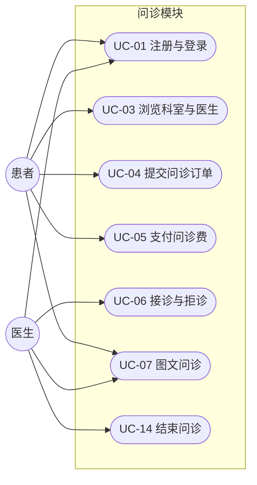
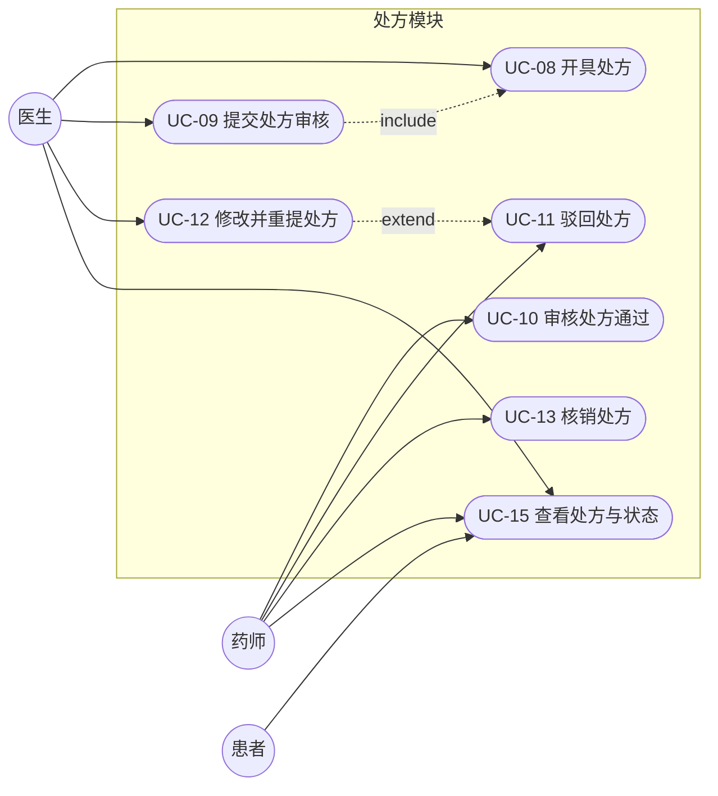
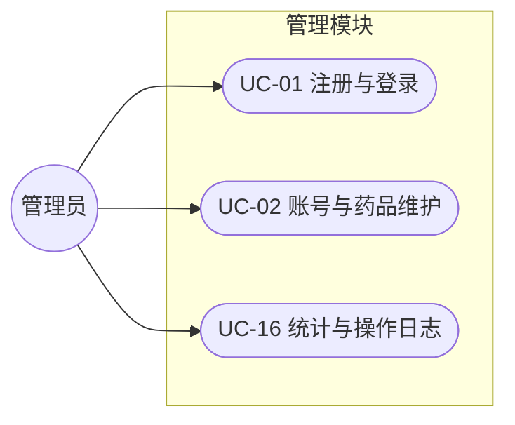
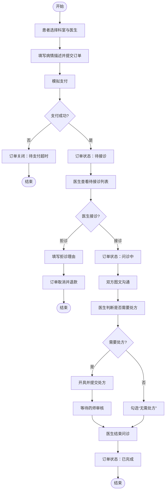
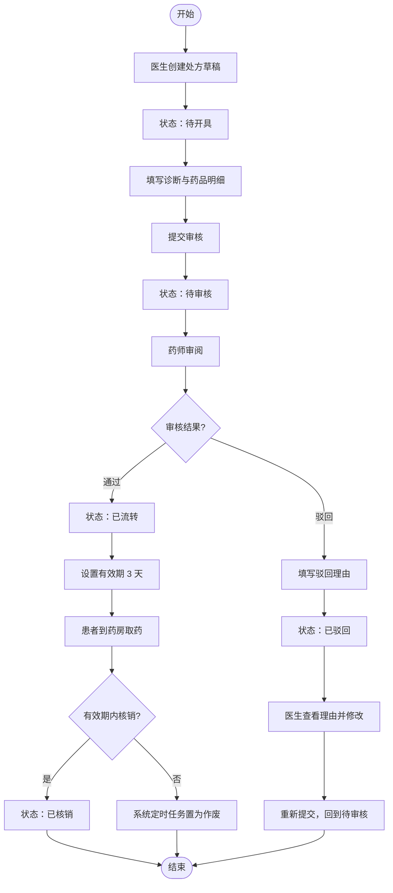
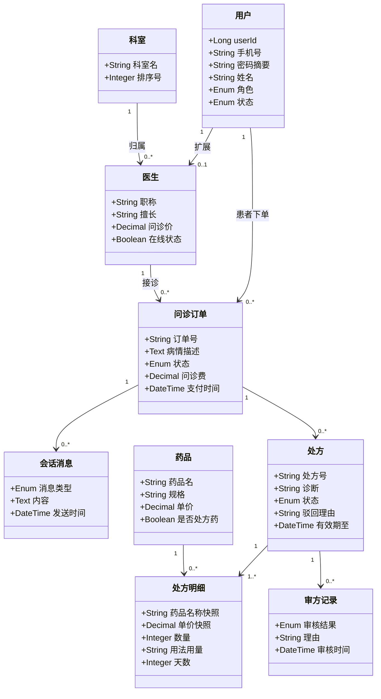
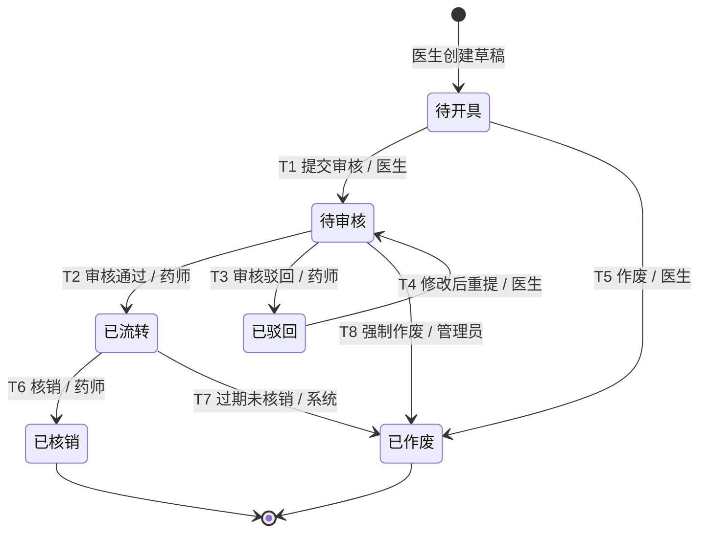

# 需求基线 UML 图

本页使用 GitHub 原生支持的 Mermaid 渲染，不依赖图片 CDN。PlantUML 源文件仍保留在同一目录，便于继续维护。

## 1. 问诊模块用例图

源文件：[`use-case-consultation.puml`](use-case-consultation.puml)

## 2. 处方模块用例图

源文件：[`use-case-prescription.puml`](use-case-prescription.puml)

## 3. 管理模块用例图

源文件：[`use-case-admin.puml`](use-case-admin.puml)

## 4. 活动图：问诊主流程

源文件：[`activity-consultation.puml`](activity-consultation.puml)

## 5. 活动图：处方流转

源文件：[`activity-prescription.puml`](activity-prescription.puml)

## 6. 领域模型类图

源文件：[`domain-model.puml`](domain-model.puml)

## 7. 处方状态图

源文件：[`state-prescription.puml`](state-prescription.puml)

